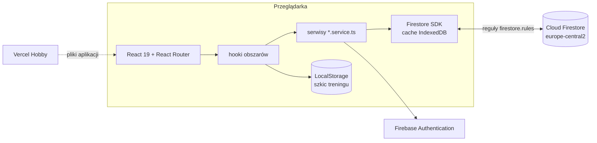
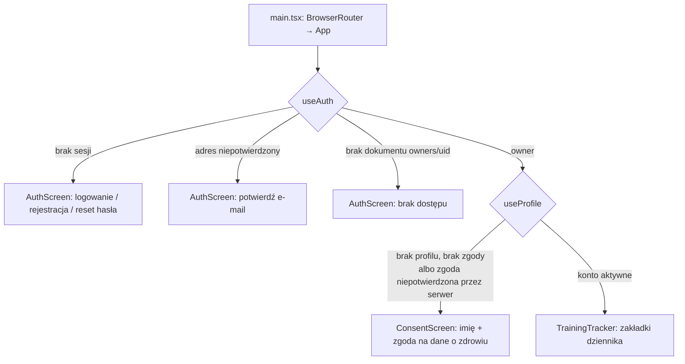

# Dziennik Treningowy — architektura

Jak aplikacja jest zbudowana teraz: części, przepływ danych, model danych i granica bezpieczeństwa. Dlaczego tak — decyzje w [DECISIONS.md](DECISIONS.md); dokąd zmierza — [ROADMAP.md](ROADMAP.md); uruchomienie i polecenia — [README.md](../README.md).

## Przegląd

Jednostronicowa aplikacja (SPA) bez własnego backendu ([ADR-0002](adr/0002-spa-firebase.md)). Przeglądarka rozmawia bezpośrednio z Firebase, a granicą bezpieczeństwa są reguły `firestore.rules`.



| Element | Technologia | Gdzie w repozytorium |
|---|---|---|
| Interfejs | React 19, TypeScript `strict`, Tailwind CSS 3, Lucide | `src/` |
| Nawigacja | React Router, adres dla każdej zakładki ([ADR-0010](adr/0010-web-app-architecture.md)) | `src/constants/routes.ts`, `src/app/TrainingTracker.tsx` |
| Model danych | schematy Zod, typy przez `z.infer` | `src/types/` |
| Logowanie | Firebase Authentication: Google albo e-mail z hasłem ([ADR-0008](adr/0008-accounts-and-invitations.md)) | `src/features/auth/` |
| Dane | Cloud Firestore na planie Spark ([ADR-0009](adr/0009-cloud-functions-aggregates.md)) | serwisy w `src/features/*/` |
| Bezpieczeństwo | reguły z walidacją zapisów | `firestore.rules`, testy w `tests/rules/` |
| Hosting | Vercel, wdrożenie z gałęzi `main` ([ADR-0011](adr/0011-environments-hosting-monitoring.md)) | `vercel.json` |
| Skrypty danych | Firebase Admin SDK, uruchamiane lokalnie | `scripts/`, testy w `tests/scripts/` |

## Start aplikacji i dostęp

Dziennik otwiera się dopiero po przejściu trzech bramek. Każdą sprawdzają też reguły, więc UI tylko odzwierciedla to, na co pozwoli baza.



- **Lista `owners`** to tymczasowa lista dostępu do czasu polityki prywatności ([ADR-0016](adr/0016-roles-views-exercise-library.md), pkt 8). Dokument zakłada się ręcznie w konsoli.
- **Zgoda** jest warunkiem aktywacji konta ([ADR-0015](adr/0015-accounts-roles-consent.md)). `App.tsx` czeka na profil potwierdzony przez serwer, bo reguły czytają zapisany profil i odrzuciłyby zapytania wysłane wcześniej.
- **Role** (`roles` w `users/{uid}`) zapisuje tylko administrator w konsoli. Aplikacja jeszcze ich nie używa: wszystkie konta widzą te same zakładki.

## Struktura kodu

Kod jest podzielony według funkcji ([ADR-0010](adr/0010-web-app-architecture.md), pkt 5). Komponenty, hook, serwis i testy jednego obszaru leżą razem.

| Katalog | Odpowiedzialność |
|---|---|
| `src/app/TrainingTracker.tsx` | układ dziennika, trasy, hooki danych wspólne dla zakładek, komunikaty błędów |
| `src/features/auth/` | logowanie, rejestracja, potwierdzenie adresu, reset hasła, sprawdzenie `owners` |
| `src/features/profile/` | profil, zgoda na dane o zdrowiu, ekran zgody, Ustawienia (`/settings`) |
| `src/features/dashboard/` | Start (`/`): szybkie statystyki, ostatnie pomiary, szablony do rozpoczęcia treningu |
| `src/features/workouts/` | trening (`/workout`): szkic w LocalStorage, serie, zapis do `sessions` |
| `src/features/history/` | historia (`/history`): lista i szczegóły treningów, usuwanie |
| `src/features/templates/` | szablony (`/templates`): domyślne w kodzie, własne w Firestore, import z przeglądarki |
| `src/features/plan/` | plan tygodnia (`/plan`): szablon przypisany do dnia |
| `src/features/measurements/` | pomiary: formularz, widżet, różnice wagi i talii |
| `src/features/progress/` | postępy (`/progress`): liczba treningów, zmiany pomiarów |
| `src/components/common/` | wspólne elementy UI: modal, toasty, formularz, nawigacja, nagłówek |
| `src/hooks/` | hooki wspólne dla obszarów (`useModal`) |
| `src/types/` | schematy Zod — jedyne źródło prawdy o kształcie danych ([AGENTS.md](../AGENTS.md#7-kontrakt-danych)) |
| `src/utils/` | walidacja odczytu (`parse.utils.ts`), daty, formularze |
| `src/constants/` | komunikaty błędów, adresy tras, reguły walidacji, treść zgody |
| `src/services/storage/` | jedyny dostęp do LocalStorage (`LocalStorageService`, klucze `STORAGE_KEYS`) |
| `src/lib/firebaseConfig.ts` | inicjalizacja Firebase, cache offline, połączenie z emulatorami |

Szablony, Plan, Historia i Postępy są ładowane leniwie. Po zalogowaniu aplikacja pobiera je w tle, żeby otworzyły się także po utracie sieci.

## Przepływ danych

```
komponent  →  hook obszaru  →  serwis *.service.ts  →  Firestore SDK (cache)  →  reguły  →  baza
  (UI)        (stan, błąd       (jedyny import          (zapis od razu
               po polsku)        firebase/*, Zod)         w cache, potem na serwer)
```

1. **Odczyt przez nasłuch.** Serwis wystawia `subscribe(uid, onChange, onError)` na `onSnapshot`. Każdy dokument przechodzi przez parser Zod, a niepoprawny jest pomijany i logowany po identyfikatorze.
2. **Zapis z identyfikatorem z klienta.** `setDoc` pod identyfikatorem nadanym w przeglądarce. Ponowny zapis, np. po odświeżeniu strony z zapisem czekającym offline, nadpisuje ten sam dokument zamiast tworzyć duplikat.
3. **Stan po zapisie aktualizuje nasłuch**, nie kod. Hook zwraca `true`, gdy Firestore potwierdził zapis.
4. **Błędy.** Serwis loguje (`console.error` z nazwą operacji) i przepuszcza wyjątek. Hook zamienia go na komunikat z `src/constants/messages.ts`, a UI pokazuje go w toaście albo w formularzu.
5. **Granice importów.** Komponenty i hooki nie importują `firebase/firestore` ani `firebase/auth`; pilnuje tego ESLint (`no-restricted-imports`).

## Model danych

Dane konta leżą w `users/{uid}/…` ([ADR-0005](adr/0005-data-model-and-access.md)). Właściciel wynika ze ścieżki, więc reguły i testy A/B są proste.

| Ścieżka | Schemat (`src/types/`) | Reguła | Zawartość |
|---|---|---|---|
| `users/{uid}` | `UserProfileDocumentSchema` | `isValidProfile` | imię, zgoda `consents.health` (stan, wersja, czas serwera), `roles` |
| `users/{uid}/sessions/{id}` | `WorkoutDocumentSchema` | `isValidWorkout` | trening: typ, data, ćwiczenia z nazwą i seriami (`weight`, `reps`, `rir` jako napisy), notatki |
| `users/{uid}/measurements/{id}` | `MeasurementDocumentSchema` | `isValidMeasurement` | data, waga, obwód talii |
| `users/{uid}/weekPlans/default_week_plan` | `WeekPlanDocumentSchema` | `isValidWeekPlan` | dzień tygodnia → id szablonu albo `null` (odpoczynek) |
| `users/{uid}/templates/{id}` | `WorkoutTemplateSchema` | `isValidTemplate` | szablony własne: nazwa, lista ćwiczeń (tekst), kategoria, wygląd |
| `owners/{uid}` | — | tylko `get` własnego | lista dostępu, zakładana w konsoli |
| `workouts`, `measurements`, `weekPlans` w korzeniu | — | brak dostępu | dane sprzed migracji do usunięcia skryptem ([KNOWN_ISSUES #21](KNOWN_ISSUES.md)) |

Poza Firestore:

- **Szablony domyślne** są w kodzie (`src/features/templates/defaultTemplates.ts`), nie w bazie.
- **LocalStorage**: `currentWorkoutDraft` — szkic trwającego treningu, usuwany po potwierdzonym zapisie albo przy wylogowaniu; `customTemplates` — szablony z dawnych wersji, przenoszone jednorazowo do Firestore i potem usuwane (`useTemplates`). `workouts` i `measurements` — dane z pierwszych wersji, już nieczytane. Szkic nie jest związany z kontem, dlatego wylogowanie usuwa wszystkie wpisy aplikacji (`STORAGE_KEYS`).

Ograniczenia obecnego modelu, które zmienia etap 1 ([ADR-0007](adr/0007-exercises-and-sets.md)):

- Ćwiczenie to tekst z nazwą i zaleceniem w jednym napisie, a serie to napisy. Nie da się liczyć postępu dla ćwiczenia.
- Reguły nie potrafią iterować po listach, więc elementy list `exercises` w treningach i szablonach sprawdza tylko schemat Zod przy odczycie. Reguły ograniczają liczbę elementów.

Docelowy model (biblioteka `exercises`, `programs`, `coaching`, `invites`) jest opisany w [ROADMAP.md](ROADMAP.md#model-danych-szkic-szczegóły-w-adr-0005).

## Bezpieczeństwo

Reguły w `firestore.rules` składają się z trzech warunków dostępu i walidatora dla każdej kolekcji:

| Funkcja | Warunek |
|---|---|
| `isVerified()` | zalogowany, adres e-mail potwierdzony |
| `isOwner()` | `isVerified()` + dokument `owners/{uid}` + `consents.health.accepted == true` w profilu |
| `isActiveSelf()` | `isOwner()` i ścieżka `users/{uid}` należy do zalogowanego |

- Własny profil zapisze każde konto z potwierdzonym adresem. Nie może go jednak utworzyć z polem `roles` ani zmienić tego pola przy aktualizacji, a czas zgody musi być czasem serwera (`request.time`).
- Każdy zapis ma walidator kształtu i zakresów. Zakresy pomiarów odpowiadają `VALIDATION_RULES` w `src/constants/validation.ts`.
- Konfiguracja `VITE_*` trafia do bundla i nie jest tajna. Klucze serwisowe nigdy nie trafiają do repozytorium ([AGENTS.md](../AGENTS.md#4-bezpieczeństwo)).
- **Reguł nie wdraża Vercel.** Po zmianie `firestore.rules` trzeba je opublikować osobno: w konsoli Firebase albo przez `npx firebase deploy --only firestore:rules`.

## Offline i dane na żywo

- `persistentLocalCache` z `persistentMultipleTabManager`: dane w IndexedDB wspólnej dla kart. Zapisy offline czekają w kolejce i wysyłają się po powrocie sieci.
- Zmiana w jednej karcie pojawia się w innej bez odświeżania, bo działają nasłuchy.
- Wylogowanie czyści cache Firestore i wpisy LocalStorage aplikacji, a potem przeładowuje stronę, żeby dane nie zostały na wspólnym komputerze ani nie trafiły do następnego konta. Przy trwającym treningu aplikacja najpierw pyta o potwierdzenie. Zapisy czekające offline giną razem z cache ([KNOWN_ISSUES #30](KNOWN_ISSUES.md)).
- Strona nie otworzy się bez sieci, jeśli wcześniej nie była otwarta, bo nie ma service workera ([ADR-0013](adr/0013-offline-app-shell.md), [KNOWN_ISSUES #17](KNOWN_ISSUES.md)).

## Środowiska, build i wdrożenie

| Środowisko | Projekt Firebase | Jak uruchomić |
|---|---|---|
| Lokalnie | emulatory `demo-training-tracker` (Auth, Firestore) | `npm run emulators` + `npm run dev` z `VITE_USE_EMULATORS=true` |
| Testy | te same emulatory | `npm run test:rules`, `npm run test:e2e` |
| Produkcja | `training-tracker-6d13b` | Vercel buduje `main`; podglądy PR nie logują się do produkcji |

- Vite dzieli kod zewnętrzny na stałe części: `react`, `zod`, `react-router` i `vendor` (głównie Firebase). Część `vendor` przekracza ostrzeżenie 500 kB ([KNOWN_ISSUES #22](KNOWN_ISSUES.md)).
- `vercel.json` kieruje każdy adres do `index.html`, więc odświeżenie zakładki działa.

## Testy i kontrola jakości

| Rodzaj | Narzędzie | Gdzie | Co sprawdza |
|---|---|---|---|
| Jednostkowe i komponentów | Vitest, Testing Library, jsdom | `src/**/*.test.ts(x)` | logika, hooki, formularze |
| Reguły i skrypty danych | Vitest + emulator Firestore | `tests/rules/`, `tests/scripts/` | dostęp własne/cudze, walidacja zapisów, migracja |
| End-to-end | Playwright na zbudowanej aplikacji i emulatorach | `e2e/` | logowanie, zgoda, trening po odświeżeniu i offline, trasy |
| Ręczne | lista kontrolna | [MANUAL_TESTING_CHECKLIST.md](MANUAL_TESTING_CHECKLIST.md) | scenariusze, których nie da się zautomatyzować |

Hook `pre-push` w `.githooks/` uruchamia lint, build i testy jednostkowe. Testy reguł i E2E uruchamia, gdy zmiana ich dotyczy. Trzeba go włączyć raz na klon. CI w GitHub Actions robi to samo, ale uruchamiane jest tylko ręcznie. Polecenia: [AGENTS.md](../AGENTS.md#weryfikacja).

## Skrypty danych

`scripts/` zawiera jednorazowe operacje na produkcji, które wymagają uprawnień administratora. Zasady wspólne dla skryptów:

- domyślnie działają w trybie próbnym, a zapisują dopiero z `--apply`;
- są idempotentne (te same identyfikatory dokumentów);
- nie zmieniają danych źródłowych, a usuwają je tylko po sprawdzeniu, że każdy dokument ma identyczną kopię, i po zapisaniu ich do pliku;
- na końcu sprawdzają wynik;
- mają testy na emulatorze w `tests/scripts/`.

| Skrypt | Działanie |
|---|---|
| `migrate-to-users.ts` | kopiuje `workouts` → `users/{uid}/sessions`, `measurements` i `weekPlans` do `users/{uid}/…` ([ADR-0016](adr/0016-roles-views-exercise-library.md), pkt 7) |
| `remove-root-collections.ts` | zapisuje `workouts`, `measurements` i `weekPlans` z korzenia bazy do pliku JSON i usuwa je, gdy każdy dokument ma identyczną kopię w `users/{uid}/…` |

Skrypty są w TypeScripcie i uruchamia je bezpośrednio Node.js 22.18 lub nowszy. Poświadczenia: `gcloud auth application-default login`. Instrukcja: [README](../README.md#usunięcie-kolekcji-sprzed-migracji-jednorazowo).
